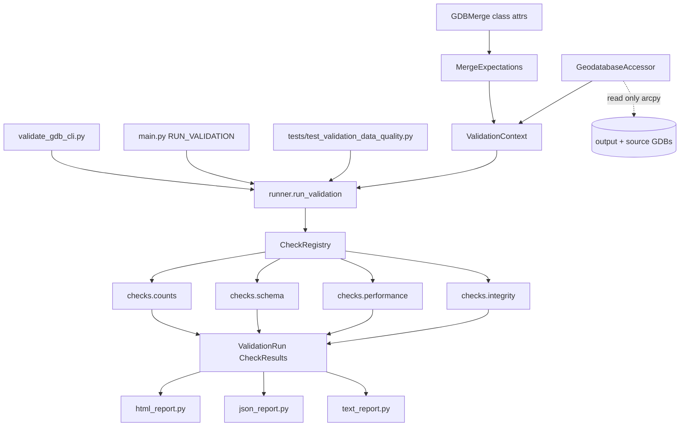

# Recommendation

### Recommended Data Testing Model

**A check-registry engine with a thin pytest layer**, split into four check families, emitting three report artifacts.

The model separates four concerns that are usually tangled together in geodatabase QA scripts:

| Concern | Owned by | Why separate |
|---|---|---|
| *What should be true* | `MergeExpectations`, derived from `GDBMerge` class attributes | Expectations are never hand-copied, so they cannot drift from the build config |
| *How to ask the GDB* | `GeodatabaseAccessor` (the only arcpy-touching code) | Lets every check be unit-tested against a fake with zero arcpy and zero data |
| *What to verify* | Check functions in a registry, each returning a `CheckResult` | Checks are independent, individually runnable, and uniformly reportable |
| *How to present it* | Report writers (HTML / JSON / TXT) + a pytest wrapper | One run feeds both a human report and CI pass/fail |

### Why this model for this dataset

Three facts about this specific build drove the choice:

1. **`GDBMerge` is already declarative.** `MANYTOMANY_RELATIONSHIPS`, `ONETOMANY_RELATIONSHIPS`, `KEY_INDEXES`, `ATTRIBUTE_INDEXES`, `SPATIAL_INDEXES` and `REPAIR_GEOMETRY_TABLES` are plain class-level data. A validator can read them directly as its expectations — no second source of truth, and adding an index to the build automatically adds it to the validation.
2. **The output is not shaped like the sources.** In each source county GDB the five many-to-many relations are plain `Table`s; in the output they are `RelationshipClass` children. `arcpy.ListTables()` on the output returns only `ParcelAssessmentRelation`. Any validator that discovers datasets by listing will silently skip 5 of the 10 themes — so expectations must come from config, not from discovery.
3. **The dataset is big enough that query strategy is a design decision, not an implementation detail.** Measured on the live GDB, the naive approach (one `FIPS_CODE` filter per county per theme) costs 3.5–13s *per county* on the relation tables, because `FIPS_CODE` is not in `ATTRIBUTE_INDEXES` for them. One grouped `TableToNumPyArray` pass gets all 58 counties in 15.7s.

### Evidence this model works — measured, read-only, on the real data

The central count-parity claim was verified before writing this plan:

```
sum of Addresses across the 57 source county GDBs : 19,341,519
output Addresses where FIPS_CODE = '06037' (LA)   :  7,414,167
                                                    -----------
                                              total: 26,755,686
output Addresses GetCount                          : 26,755,686   exact match
```

This settles the LA problem: LA has no source GDB (it became the merge base), but it does not need one. Its contribution is recovered from the output's own `FIPS_CODE` grouping, and the identity above is the check.

Other measurements that shaped the design:

| Measurement | Result |
|---|---|
| Indexed `Addresses.CITY = 'DAVIS'` → 63,039 rows | **0.11s** |
| Unindexed `Addresses.STREET_NAME = 'OAK'` → 33,494 rows | **11.34s** |
| Indexed `Addresses.ZIP = '95616'` → 2,502 rows | **0.07s** |
| `SelectLayerByLocation`, Davis-sized bbox on 11.6M Parcels → 14,894 rows | **0.24s** |
| Grouped `FIPS_CODE` pass over 26.1M-row `AddressParcelRelation` | **15.71s**, 58 counties |
| `GetCount` on `Addresses` across all 57 source GDBs | **12.68s** |
| Orphan sample: 500 `address_lid` from `AddressParcelRelation` → `Addresses` | **500/500 matched, 0.84s** |

The ~100x indexed/unindexed gap at comparable result-set sizes is what makes the ratio-based pass criterion viable: it is a signal so large that machine speed, disk, and cache state cannot wash it out.

### What a run produces

One invocation writes three artifacts to a timestamped folder: a **self-contained HTML report** (status badges, per-county count tables, timing columns), a **JSON results file** for diffing runs over time, and a **plain-text digest** for pasting into email or a ticket.

### Safety

Every operation is read-only. The accessor exposes only `GetCount`, `MakeTableView`, `MakeFeatureLayer`, `SelectLayerBy*`, `SearchCursor`, `ListFields`, `ListIndexes`, `Describe`, and `TableToNumPyArray`. No `Append`, `Delete`, `AddIndex`, `RepairGeometry`, `CalculateField`, or `Rename` is imported or called anywhere in the module. The 8–24 hour build is never at risk.

# Requirements

### Overview & Goals

Add a read-only validation module that runs after `compile_gdbs.py` finishes and answers one question with evidence: *did the merge produce a correct, well-indexed, queryable statewide geodatabase?*

It verifies four properties and writes a report:

1. **Completeness** — every county's records made it in, exactly once.
2. **Conformance** — the schema and every declared index actually exist.
3. **Performance** — indexed attribute queries and spatial queries are fast because the indexes are working, not by accident.
4. **Integrity** — the relationship keys actually resolve.

### Scope

**In scope**

- A `unbox/validation` package containing the check engine, the four check families, and the report writers.
- A `validate_gdb_cli.py` entry point at project root, styled after the existing `build_locator_cli.py`.
- An opt-in call from `main.py` after `m.run_merge()`, guarded by a `RUN_VALIDATION` flag.
- A pytest wrapper so validation results surface as ordinary test failures.
- Unit tests using a fake accessor (no arcpy, no data) plus data-quality tests against the real GDBs.
- `documentation/` pages for operators and developers; a new root `FEATURES.md`; a run summary in `.junie/reports/`.

**Out of scope**

- Any write, repair, or rebuild operation against the geodatabase.
- Changes to the merge logic in `compile_gdbs.py`. The only edit outside the new module is the opt-in hook in `main.py`.
- Locator / geocoder validation — `build_locator.py` is untouched.
- Content-level correctness of LightBox attributes (e.g. whether an address is *right*). This verifies the merge and the database, not the vendor data.
- New third-party packages. `pytest` 8.4.2, `pandas` 3.0.0, `jinja2` 3.1.6, `numpy` 2.3.5 and `click` 8.2.1 are already in `arcgispro-py3`.

### User Stories

- As the data steward, I want to confirm after an overnight build that no county was dropped or double-appended, so that I do not publish a statewide dataset with a missing county.
- As the data steward, I want proof that indexed fields respond quickly, so that I can tell subscribing departments the database is fit for interactive use in ArcGIS Pro.
- As a subscribing department, I want assurance that relationship classes traverse correctly, so that clicking a parcel reliably returns its assessments and buildings.
- As a developer, I want validation runnable as a CLI *and* as pytest, so that I can iterate on one county locally and still get a pass/fail gate for the full state.

### Functional Requirements

**Count parity**

- Compare, per county and per theme, the source GDB row count against the output row count for that `FIPS_CODE`.
- Cover all ten themes: `Parcels`, `Addresses`, `Buildings`, `Assessments`, `ParcelAssessmentRelation`, and the five M2M relations now stored as relationship classes.
- Reconcile the merge-base county (LA, `06037`) without a source GDB, by asserting `sum(sources) + output[base] == output total`.
- Fail if a county present in the sources is absent from the output, if any count differs, or if the output contains an unexpected `FIPS_CODE`.
- Accept a `--counties` filter to restrict the sweep during development; full sweep is the default.
- Accept an optional `--base_county_gdb` so LA can be compared directly if a copy is ever available.

**Schema & index conformance**

- For each theme, compare output field names, types, and lengths against a reference source county, reporting missing, extra, and mismatched fields.
- Assert every `KEY_INDEXES` and `ATTRIBUTE_INDEXES` entry exists as `idx_<FIELD>` on its table, matching case-insensitively on the field.
- Assert every `SPATIAL_INDEXES` feature class carries an `FDO_SHAPE` spatial index.
- Assert all five M2M relationship classes and all three `rc_`-prefixed one-to-many relationship classes exist, with the expected origin, destination, keys, and cardinality.

**Query performance**

- Time `SelectLayerByAttribute` on each indexed field and compare against a timed full-scan control query on an unindexed field of the same table, chosen to return a comparable number of rows.
- Time `SelectLayerByLocation` with small, medium, and large bounding boxes against each spatially indexed feature class.
- Pass when the indexed query is at least `--perf_min_speedup` times faster than the control scan (default `5.0`, against an observed ~100x).
- Run a discarded warmup before each timed query and report cold and warm timings separately.
- Report absolute seconds and result counts for every timing, whether or not it passes.

**Referential integrity**

- Sample N keys (default 500, `--sample_size`) from each relationship table and confirm each resolves to a row in the referenced feature class.
- Confirm `Parcels.primary_assessment_lid` and `Parcels.primary_building_lid` resolve, tolerating nulls.
- Confirm `FIPS_CODE` on each relation row agrees with the `FIPS_CODE` of the rows it links.
- Report orphan rate per relation; fail above a configurable tolerance (default: zero orphans).

**Reporting**

- Write `validation_report.html`, `validation_results.json`, and `validation_summary.txt` into a timestamped folder under `--report_dir`.
- HTML shows an overall verdict, per-category rollups, and expandable per-check tables; it must be a single self-contained file that opens without a web server.
- JSON carries every `CheckResult` field so runs can be diffed and a future baseline comparison can be layered on.
- Exit non-zero when any check fails, so the CLI can gate a pipeline.

### Non-Functional Requirements

- **Strictly read-only.** No write-capable arcpy function may be called. This is enforced by a unit test asserting the forbidden names never appear in the module source.
- **Bounded runtime.** A full-state run should finish in roughly 10–20 minutes; a `--counties` subset run in under a minute.
- **Graceful degradation.** A failing check records `ERROR` with its traceback and the run continues, so one bad theme never costs the whole report.
- **Readable output.** The HTML report must be understandable by someone who has never read this codebase.

# Technical Design

### Current Implementation

`unbox/compile_gdbs.py` defines `GDBMerge`, driven by `main.py`. `run_merge()` extracts zips, promotes the largest county GDB to become the output, repairs geometry, converts the five M2M tables to attributed relationship classes, drops indexes, appends all counties, recreates attribute and spatial indexes, and finally creates the three `rc_` one-to-many relationship classes.

Crucially, the merge's intent is already expressed as data on the class:

```python
MANYTOMANY_RELATIONSHIPS = [...]   # 5 entries: RelationName, Origin, Destination, OriginKey, DestinationKey
ONETOMANY_RELATIONSHIPS  = [...]   # 3 entries, prefixed rc_ at creation time
KEY_INDEXES              = [...]   # 20 (table, field) pairs
ATTRIBUTE_INDEXES        = [...]   # 29 (table, field) pairs
SPATIAL_INDEXES          = ["Parcels", "Buildings", "Addresses", "Assessments"]
```

These are class attributes, readable without instantiating `GDBMerge` or touching the filesystem — which is what makes the expectations layer possible.

**Verified state of the live output GDB** (`full_state_smartfabric_20261020.gdb`):

```
FeatureClass      Addresses, Buildings, Assessments, Parcels
Table             ParcelAssessmentRelation
RelationshipClass BuildingParcelRelation, BuildingAssessmentRelation,
                  AddressParcelRelation, AddressBuildingRelation,
                  AddressAssessmentRelation,
                  rc_ParcelAssessments, rc_ParcelPrimaryAssessment,
                  rc_ParcelPrimaryBuilding
```

Row counts: Parcels 11,626,666 · Addresses 26,755,686 · Buildings 12,854,727 · Assessments 13,243,721 · ParcelAssessmentRelation 13,008,145 · BuildingParcelRelation 16,955,738 · AddressParcelRelation 26,124,556. All 58 FIPS codes present. Every expected `idx_*` index confirmed present on `Parcels`, `Addresses`, and `BuildingParcelRelation`.

The 57 source GDBs in `processing_20261020` each expose all ten themes as `FeatureClass` or `Table`.

The existing test suite (`tests/`) is thin: `test_gdbmerge_instantiation.py` is pure unit, `test_parcel_locator_prep.py` and `test_small_merge.py` are heavyweight integration tests with paths from `tests/config.py` pointing at an older delivery.

### Key Decisions

**1. Expectations are derived from `GDBMerge`, never duplicated.**
`MergeExpectations.from_merge_class(GDBMerge)` reads the class attributes and projects them into validation-shaped expectations — including applying `ONETOMANY_RELATIONSHIPS_PREFIX` and the `idx_<FIELD>` naming convention from `create_indexes()`. Adding an index to the build automatically extends the validation.

**2. One arcpy seam: `GeodatabaseAccessor`.**
Every arcpy call lives behind this one class. Checks receive it through `ValidationContext` and never import arcpy. This is what makes the engine unit-testable with a `FakeGeodatabaseAccessor` and no data at all.

**3. Count by grouped single pass, not per-county queries.**
Measured: filtering the output by `FIPS_CODE` costs 0.18–0.37s on feature classes but **3.5–13.4s on the relation tables**, because `ATTRIBUTE_INDEXES` indexes `FIPS_CODE` on `Parcels`/`Buildings`/`Addresses`/`Assessments` but not on the relations. Naively that is 58 × 13s ≈ 13 minutes for a single theme. Instead, `count_by_field()` does **one** `TableToNumPyArray` pass over `FIPS_CODE` and groups with `numpy.unique` — 15.71s for all 58 counties of the 26.1M-row `AddressParcelRelation`. Sources stay on plain `GetCount` (12.68s for 57 GDBs).

**4. Performance pass/fail by indexed-vs-unindexed ratio.**
Absolute second budgets would need retuning per machine. The ratio self-calibrates. The control field is picked deterministically: the first string field of the table that appears in no index, with a sampled value yielding a comparable result count. The observed gap (0.11s vs 11.34s at 63k vs 33k rows) is large enough that a `5.0` default threshold is conservative.

**5. LA is reconciled arithmetically, not by file.**
`06037` has no source GDB because `move_largest_to_output()` consumed it. The check asserts `sum(source_counts) + output_count[base_fips] == output_total`, verified exact on `Addresses`. An optional `--base_county_gdb` enables direct comparison if a copy is ever supplied.

**6. Separate CLI with an opt-in hook.**
`validate_gdb_cli.py` is standalone; `main.py` gains a `RUN_VALIDATION` flag defaulting to `True` that calls the runner after `m.run_merge()`. Validation never blocks or endangers the long build.

### Architecture Diagram



### Data Models / Contracts

```python
# unbox/validation/models.py

class CheckStatus(enum.Enum):
    PASS = "pass"
    FAIL = "fail"
    WARN = "warn"      # suspicious but not disqualifying
    SKIP = "skip"      # prerequisite absent, e.g. no source folder supplied
    ERROR = "error"    # the check itself raised

@dataclasses.dataclass(frozen=True)
class CheckResult:
    check_id: str                  # "counts.per_county_theme"
    category: str                  # counts | schema | performance | integrity
    title: str
    status: CheckStatus
    summary: str                   # one human-readable sentence
    details: dict[str, Any]        # scalars for the report header
    rows: list[dict[str, Any]]     # tabular detail rendered as an HTML table
    duration_seconds: float
    started_at: datetime.datetime

@dataclasses.dataclass
class ValidationRun:
    output_gdb: str
    started_at: datetime.datetime
    finished_at: datetime.datetime | None
    results: list[CheckResult]
    @property
    def overall_status(self) -> CheckStatus: ...
    def by_category(self) -> dict[str, list[CheckResult]]: ...
```

```python
# unbox/validation/expectations.py

@dataclasses.dataclass(frozen=True)
class ExpectedIndex:
    table_name: str
    field_name: str
    index_name: str                # "idx_" + field_name, per GDBMerge.create_indexes

@dataclasses.dataclass(frozen=True)
class ExpectedRelationship:
    relationship_name: str
    origin_table: str
    destination_table: str
    origin_key: str
    destination_key: str
    cardinality: str
    is_attributed: bool

@dataclasses.dataclass(frozen=True)
class MergeExpectations:
    core_theme_names: tuple[str, ...]           # Parcels, Addresses, Buildings, Assessments
    relation_table_names: tuple[str, ...]       # the 6 relation datasets
    expected_indexes: tuple[ExpectedIndex, ...]
    spatially_indexed_tables: tuple[str, ...]
    manytomany_relationships: tuple[ExpectedRelationship, ...]
    onetomany_relationships: tuple[ExpectedRelationship, ...]

    @classmethod
    def from_merge_class(cls, merge_class=GDBMerge) -> "MergeExpectations": ...

    @property
    def all_countable_theme_names(self) -> tuple[str, ...]: ...
```

```python
# unbox/validation/gdb_access.py  -- the ONLY module importing arcpy

@dataclasses.dataclass(frozen=True)
class TimedQueryResult:
    where_clause: str | None
    matched_row_count: int
    cold_seconds: float
    warm_seconds: float

class GeodatabaseAccessor:
    """Read-only facade over arcpy. Contains no write-capable operations."""
    def describe_children(self, gdb_path) -> dict[str, str]          # name -> dataType
    def dataset_exists(self, gdb_path, dataset_name) -> bool
    def get_row_count(self, gdb_path, dataset_name) -> int
    def count_rows_by_field(self, gdb_path, dataset_name,
                            field_name="FIPS_CODE") -> dict[str, int]
    def list_field_definitions(self, gdb_path, dataset_name) -> list[FieldDefinition]
    def list_index_definitions(self, gdb_path, dataset_name) -> list[IndexDefinition]
    def describe_relationship_class(self, gdb_path, name) -> RelationshipDefinition
    def time_attribute_selection(self, gdb_path, dataset_name,
                                 where_clause) -> TimedQueryResult
    def time_spatial_selection(self, gdb_path, feature_class_name,
                               extent) -> TimedQueryResult
    def sample_field_values(self, gdb_path, dataset_name, field_names,
                            where_clause=None, limit=500) -> list[tuple]
    def count_matching_keys(self, gdb_path, dataset_name,
                            key_field, key_values) -> int
```

```python
# unbox/validation/registry.py

CheckFunction = Callable[["ValidationContext"], CheckResult | Iterable[CheckResult]]

def register_check(check_id: str, category: str, title: str,
                   requires_source_folder: bool = False) -> Callable: ...

class CheckRegistry:
    def register(self, descriptor: CheckDescriptor) -> None: ...
    def select(self, categories=None, check_ids=None) -> list[CheckDescriptor]: ...
```

```python
# unbox/validation/runner.py

def run_validation(context: ValidationContext,
                   categories: Sequence[str] | None = None) -> ValidationRun:
    """Executes selected checks in order, isolating exceptions into ERROR results."""
```

### Proposed Changes

**Counts** (`checks/counts.py`) — three checks. `counts.county_coverage` compares the FIPS set found in the sources against the set found in the output, plus the base county. `counts.per_county_theme` runs one grouped `count_rows_by_field` per output theme and one `get_row_count` per source GDB per theme, emitting a row per (county, theme) with source, output, and delta. `counts.base_county_reconciliation` asserts the `sum(sources) + output[base] == output total` identity per theme.

**Schema** (`checks/schema.py`) — `schema.field_conformance` diffs output fields against a reference source county, tolerating the known `RID`-instead-of-`OBJECTID` difference on attributed relationship classes. `schema.attribute_indexes` and `schema.spatial_indexes` walk `MergeExpectations`. `schema.relationship_classes` describes each expected relationship class and compares origin, destination, keys, and cardinality.

**Performance** (`checks/performance.py`) — `performance.establish_scan_baseline` times the unindexed control query per table once and caches it on the context. `performance.indexed_attribute_queries` times one selection per indexed field, using a sampled real value, and computes the speedup ratio. `performance.spatial_queries` times small/medium/large bbox selections per spatially indexed feature class against the same baseline. All timings land in the report regardless of verdict.

**Integrity** (`checks/integrity.py`) — `integrity.relationship_orphans` samples keys from each relation and resolves them via a batched `IN` clause (measured at 0.84s for 500 keys). `integrity.primary_key_resolution` checks the `primary_*_lid` fields on `Parcels`. `integrity.fips_consistency` confirms relation rows agree with the counties of the features they link.

**Reporting** — `report.html.j2` renders a self-contained document with inline CSS; `json_report.py` serialises the full `ValidationRun`; `text_report.py` emits a fixed-width digest. All three write into `<report_dir>/validation_<yyyymmdd>_<hhmmss>/`.

**CLI** — `validate_gdb_cli.py` mirrors `build_locator_cli.py`: `click.command`, `CONTEXT_SETTINGS` with `-h/--help`, a `_validate_path_or_url`-style callback, and a `main(cfg)` that echoes the parsed configuration before running. Options: `--output_gdb` (required), `--source_folder`, `--base_county_gdb`, `--base_fips` (default `06037`), `--counties`, `--categories`, `--report_dir`, `--report_formats`, `--perf_min_speedup` (default `5.0`), `--sample_size` (default `500`), `--orphan_tolerance` (default `0`).

**`main.py` hook** — add `RUN_VALIDATION = True` near `REMOVE_EXISTING`, and after `m.run_merge()` build a context from `output_gdb` / `temp_folder` and write the report into `temp_folder`.

### File Structure

```
unbox/validation/
    __init__.py                 run_validation + ValidationContext re-exports
    models.py                   CheckStatus, CheckResult, ValidationRun, ValidationContext
    expectations.py             MergeExpectations.from_merge_class(GDBMerge)
    gdb_access.py               GeodatabaseAccessor  (only arcpy importer)
    registry.py                 CheckDescriptor, CheckRegistry, @register_check
    runner.py                   run_validation, exception isolation
    checks/
        __init__.py             imports submodules to populate the registry
        counts.py  schema.py  performance.py  integrity.py
    reporting/
        __init__.py  html_report.py  json_report.py  text_report.py
        templates/report.html.j2

validate_gdb_cli.py             (new, project root)
main.py                         (modified: RUN_VALIDATION flag + post-merge call)
tests/config.py                 (modified: add 20261020 delivery paths)
tests/test_validation_expectations.py       (new, unit)
tests/test_validation_registry_runner.py    (new, unit)
tests/test_validation_checks_counts.py      (new, unit, fake accessor)
tests/test_validation_checks_schema.py      (new, unit, fake accessor)
tests/test_validation_checks_performance.py (new, unit, fake accessor)
tests/test_validation_checks_integrity.py   (new, unit, fake accessor)
tests/test_validation_reporting.py          (new, unit)
tests/test_validation_read_only.py          (new, unit, source-scan guard)
tests/test_validation_data_quality.py       (new, integration, real GDBs)
tests/fakes/fake_gdb_accessor.py            (new, in-memory accessor)
documentation/validation_user_guide.md      (new)
documentation/validation_developer_guide.md (new)
FEATURES.md                                 (new, project root)
.junie/reports/summary_<date>_<time>.md     (new)
```

### Risks

- **Dataset-type asymmetry.** The five M2M relations are `Table` in sources and `RelationshipClass` in the output. *Mitigation:* expectations come from `GDBMerge`, never from `ListTables()`; the accessor resolves a dataset by path regardless of type, which was confirmed working for both `GetCount` and `MakeTableView`.
- **`RID` vs `OBJECTID`.** Attributed relationship classes use `RID` as the OID field. *Mitigation:* the schema check holds an explicit allowance for this known, intentional difference.
- **Field-name casing drift.** `ATTRIBUTE_INDEXES` mixes cases (`"Parcel_LID"` vs `PARCEL_LID` as reported by `ListIndexes`). *Mitigation:* all field and index matching is case-insensitive.
- **Cache warming distorts timings.** The first `Parcels` `GetCount` took 5.99s and later calls 0.14s. *Mitigation:* a discarded warmup precedes each timed query; cold and warm are reported separately and the ratio uses warm.
- **Control-field selection could pick a degenerate field.** A control that returns 3 rows gives a meaningless ratio. *Mitigation:* the control value is sampled and the result count checked to be within an order of magnitude of the indexed query; if no suitable control exists the check reports `SKIP` with the reason rather than a false pass.
- **Full-state runtime.** Ten grouped passes plus 570 source counts. *Mitigation:* measured at roughly 10–20 minutes; `--counties` and `--categories` give fast iteration paths.

# Testing

### Validation Approach

Two tiers, because the module is itself code that must be trusted before its verdicts mean anything.

**Tier 1 — unit tests, no arcpy, no data, fast.** A `FakeGeodatabaseAccessor` returns scripted counts, fields, indexes, relationships, and timings from in-memory dictionaries. Every check is driven through both a healthy fixture and deliberately corrupted fixtures. This is what proves a check can actually *fail* — the most common defect in validation code is a check that silently always passes.

**Tier 2 — data-quality tests against the real GDBs.** A pytest module parametrised over the real `CheckResult` list from a single cached run, so the expensive work happens once per session and each check appears as its own named test.

### Key Scenarios

**Expectations layer**
- `MergeExpectations.from_merge_class(GDBMerge)` yields exactly 49 expected indexes (20 key + 29 attribute), 4 spatially indexed tables, 5 M2M and 3 one-to-many relationships.
- One-to-many names carry the `rc_` prefix; index names follow `idx_<field>`.
- Expectations are produced without touching the filesystem or instantiating `GDBMerge`.

**Counts**
- Healthy fixture: every county matches → `PASS`.
- A county missing from the output → `FAIL`, and the county is named in `rows`.
- A county's output count doubled (simulated double-append) → `FAIL` with a positive delta.
- An unexpected `FIPS_CODE` in the output → `FAIL`.
- Base-county reconciliation: `sum(sources) + output[06037] == total` passes; perturbing the base count by one breaks it.
- `--counties 06001,06003` restricts the emitted rows to those counties only.

**Schema**
- All declared indexes present → `PASS`; removing `idx_CITY` from the fixture → `FAIL` naming `Addresses.CITY`.
- Index matching is case-insensitive (`Parcel_LID` vs `PARCEL_LID`).
- A feature class missing `FDO_SHAPE` → `FAIL`.
- A relationship class with the wrong `origin_key` → `FAIL` showing expected vs actual.
- `RID` present instead of `OBJECTID` on an attributed relationship class → `PASS` (known allowance).

**Performance**
- Fake timings of 0.1s indexed vs 11.0s control → ratio 110 → `PASS` at threshold 5.0.
- Fake timings of 9.0s vs 11.0s → ratio 1.2 → `FAIL`.
- No usable unindexed control field → `SKIP` carrying the reason, never a false `PASS`.
- Control result count outside one order of magnitude of the indexed count → `SKIP`.
- Cold and warm timings both appear in `details`.

**Integrity**
- All sampled keys resolve → `PASS`, orphan rate 0.0.
- 3 of 500 keys unresolved with tolerance 0 → `FAIL` reporting a 0.6% orphan rate.
- Null `primary_building_lid` values are tolerated, not counted as orphans.

**Runner & registry**
- Registering a duplicate `check_id` raises at import time.
- A check raising `RuntimeError` yields `ERROR` with the traceback in `details`, and later checks still execute.
- A check returning multiple `CheckResult`s is flattened into the run.
- `categories=["counts"]` runs only count checks.
- `overall_status` is `FAIL` if any result is `FAIL` or `ERROR`, else `WARN` if any is `WARN`, else `PASS`.

**Reporting**
- HTML renders from a synthetic `ValidationRun` and contains the overall verdict, every `check_id`, and every row; it is a single file with no external asset references.
- JSON round-trips: serialise then reload and confirm identical statuses and durations.
- Text digest contains one line per check with its status.
- Empty-run and all-ERROR runs render without raising.

**Read-only guard**
- A test scans every `.py` file under `unbox/validation` and asserts none contains `Append`, `Delete`, `AddIndex`, `RemoveIndex`, `AddSpatialIndex`, `RepairGeometry`, `CalculateField`, `Rename`, `CopyFeatures`, `CreateRelationshipClass`, or `DeleteFeatures`.
- A test asserts `arcpy` is imported only in `gdb_access.py`.

### Edge Cases

- `--source_folder` omitted → count checks `SKIP` cleanly; schema, performance, and integrity still run against the output alone.
- Output GDB path does not exist → clear error before any check runs.
- A source GDB missing a theme → that (county, theme) row reports `SKIP` with a reason; the sweep continues.
- A source folder containing a non-GDB directory or a partially extracted GDB → skipped with a warning.
- A theme with zero rows for a county in both source and output → `PASS`, not a division-by-zero.
- A `FIPS_CODE` value that is null or empty in the output → surfaced explicitly rather than silently grouped.
- Timing a query that returns zero rows → `SKIP`, since zero-row timings carry no information (observed: `CITY='Davis'` title-cased returns 0 rows while `'DAVIS'` returns 63,039 — values must be sampled from the data, not guessed).
- A relationship class that exists but has no rows → `WARN`, not `FAIL`.

### Test Changes

- Add the nine new unit test modules and `tests/fakes/fake_gdb_accessor.py`.
- Add `tests/test_validation_data_quality.py`, marked so it can be deselected, with a session-scoped fixture caching the single real run.
- Patch `tests/config.py` to add `DELIVERY_2026_10_*` constants for the 20261020 output GDB and `processing_20261020` source folder, leaving the existing 20251015 constants untouched so `test_parcel_locator_prep.py` and `test_small_merge.py` keep working.
- No existing test logic is modified.
- Run the full suite with `conda activate arcgispro-py3` and report results before declaring the work complete, per the project guidelines.

# Delivery Steps

###   Step 1: Build the validation core and expectations layer
A `unbox/validation` package exists whose expectations are derived from `GDBMerge`, with a read-only arcpy facade and a working registry, all covered by unit tests that run without arcpy.

- Create `unbox/validation/__init__.py`, `models.py`, `expectations.py`, `gdb_access.py`, `registry.py`, and `runner.py`.
- Define `CheckStatus`, `CheckResult`, `ValidationRun`, and `ValidationContext` in `models.py` as documented dataclasses.
- Implement `MergeExpectations.from_merge_class(GDBMerge)` in `expectations.py`, projecting `KEY_INDEXES` + `ATTRIBUTE_INDEXES` into `idx_<field>` names, applying `ONETOMANY_RELATIONSHIPS_PREFIX` to the three one-to-many relationship names, and normalising all field names for case-insensitive comparison.
- Implement `GeodatabaseAccessor` in `gdb_access.py` as the single arcpy importer, exposing only read operations: `describe_children`, `get_row_count`, `count_rows_by_field` (one `TableToNumPyArray` pass grouped with `numpy.unique`), `list_field_definitions`, `list_index_definitions`, `describe_relationship_class`, `time_attribute_selection`, `time_spatial_selection`, `sample_field_values`, and `count_matching_keys`.
- Give the timing methods a discarded warmup pass so `TimedQueryResult` can report cold and warm seconds separately.
- Implement `register_check`, `CheckDescriptor`, and `CheckRegistry`, raising on duplicate `check_id` registration.
- Implement `run_validation` in `runner.py` to execute selected descriptors in order, flatten multi-result checks, and convert any raised exception into an `ERROR` result carrying the traceback so the run continues.
- Create `tests/fakes/fake_gdb_accessor.py` implementing the accessor interface from in-memory dictionaries.
- Add `tests/test_validation_expectations.py` and `tests/test_validation_registry_runner.py` covering expectation derivation counts, the `rc_` prefix, duplicate registration, exception isolation, category filtering, and `overall_status` precedence.
- Add `tests/test_validation_read_only.py` scanning the package source to assert no write-capable arcpy call appears and that `arcpy` is imported only in `gdb_access.py`.

###   Step 2: Add the reporting layer and the validation CLI
A validation run can be invoked from the command line end-to-end and writes an HTML, JSON, and text report, even with zero checks registered.

- Create `unbox/validation/reporting/` with `html_report.py`, `json_report.py`, `text_report.py`, and `templates/report.html.j2`.
- Render the HTML with jinja2 as a single self-contained file with inline CSS: overall verdict banner, per-category rollup, and an expandable table per check driven by `CheckResult.rows`.
- Serialise the full `ValidationRun` in `json_report.py` so every field survives a round trip for future baseline diffing.
- Emit a fixed-width one-line-per-check digest in `text_report.py`.
- Write all artifacts into `<report_dir>/validation_<yyyymmdd>_<hhmmss>/` as `validation_report.html`, `validation_results.json`, and `validation_summary.txt`.
- Create `validate_gdb_cli.py` at project root following the structure of `build_locator_cli.py`: `CONTEXT_SETTINGS` with `-h/--help`, path-validating callbacks, and a `main(cfg)` that echoes the parsed configuration before running.
- Add CLI options `--output_gdb` (required), `--source_folder`, `--base_county_gdb`, `--base_fips` (default `06037`), `--counties`, `--categories`, `--report_dir`, `--report_formats`, `--perf_min_speedup` (default `5.0`), `--sample_size` (default `500`), and `--orphan_tolerance` (default `0`).
- Exit non-zero when the run's `overall_status` is `FAIL`.
- Add `tests/test_validation_reporting.py` covering HTML rendering from a synthetic run, JSON round-trip fidelity, text digest content, and the empty-run and all-`ERROR` edge cases.

###   Step 3: Implement count parity checks across counties and themes
The report shows, for all ten themes and every county, whether source and output row counts agree, with LA reconciled arithmetically.

- Create `unbox/validation/checks/counts.py` and wire `checks/__init__.py` to import it so registration happens on package import.
- Implement `counts.county_coverage` comparing the FIPS set discovered across source GDBs plus the base county against the FIPS set found in the output, failing on any missing or unexpected county.
- Implement `counts.per_county_theme` using one grouped `count_rows_by_field` call per output theme and one `get_row_count` per source GDB per theme, emitting a row per (county, theme) with source count, output count, and delta.
- Cover all ten themes including the five many-to-many relations that are relationship classes in the output but plain tables in the sources, resolving each by path rather than by listing.
- Implement `counts.base_county_reconciliation` asserting `sum(source_counts) + output_count[base_fips] == output_total` per theme, the identity verified exact on `Addresses` at 19,341,519 + 7,414,167 = 26,755,686.
- Honour the `--counties` filter to restrict the sweep, and `SKIP` cleanly when no `--source_folder` is supplied.
- Handle a source GDB missing a theme as a per-row `SKIP` with a reason rather than aborting the sweep.
- Add `tests/test_validation_checks_counts.py` driving the fake accessor through a healthy fixture plus corrupted fixtures for a missing county, a doubled county count, an unexpected FIPS code, and a perturbed base-county total.

###   Step 4: Implement schema, index, and referential integrity checks
The report confirms the output schema matches the sources, every declared index and relationship class exists, and sampled relationship keys resolve.

- Create `unbox/validation/checks/schema.py` with `schema.field_conformance` diffing output field names, types, and lengths against a reference source county, reporting missing, extra, and mismatched fields, and allowing the known `RID`-instead-of-`OBJECTID` difference on attributed relationship classes.
- Implement `schema.attribute_indexes` walking every `ExpectedIndex` from `MergeExpectations` and matching index and field names case-insensitively.
- Implement `schema.spatial_indexes` asserting `FDO_SHAPE` exists on each of the four spatially indexed feature classes.
- Implement `schema.relationship_classes` describing each of the five many-to-many and three `rc_` one-to-many relationship classes and comparing origin, destination, keys, and cardinality against expectations.
- Create `unbox/validation/checks/integrity.py` with `integrity.relationship_orphans` sampling `--sample_size` keys per relation and resolving them via a batched `IN` clause against the referenced feature class.
- Implement `integrity.primary_key_resolution` for `Parcels.primary_assessment_lid` and `Parcels.primary_building_lid`, treating nulls as valid rather than orphaned.
- Implement `integrity.fips_consistency` confirming each sampled relation row's `FIPS_CODE` agrees with the counties of the features it links.
- Report orphan rate per relation and fail above `--orphan_tolerance`; report an existing but empty relationship class as `WARN` rather than `FAIL`.
- Add `tests/test_validation_checks_schema.py` and `tests/test_validation_checks_integrity.py` covering a removed `idx_CITY`, mixed-case index matching, a missing `FDO_SHAPE`, a wrong relationship origin key, the `RID` allowance, a clean orphan sweep, a 3-of-500 orphan failure, and null-tolerant primary key resolution.

###   Step 5: Implement query performance checks using indexed-vs-unindexed ratios
The report quantifies indexed attribute and spatial query speed against a full-scan baseline and fails when an index is not delivering.

- Create `unbox/validation/checks/performance.py`.
- Implement `performance.establish_scan_baseline`, selecting a control field per table deterministically as the first string field appearing in no index, sampling a real value from the data, timing the resulting full scan, and caching the baseline on the context.
- Implement `performance.indexed_attribute_queries`, timing one `SelectLayerByAttribute` per indexed field using a value sampled from the data, and computing the speedup ratio against that table's cached baseline.
- Implement `performance.spatial_queries`, timing `SelectLayerByLocation` with small, medium, and large bounding boxes against each of the four spatially indexed feature classes and comparing against the same baseline.
- Pass when the ratio meets or exceeds `--perf_min_speedup` (default `5.0`), conservative against the measured ~100x gap of 0.11s indexed versus 11.34s unindexed at comparable row counts.
- Report `SKIP` with an explicit reason, never a false `PASS`, when no usable control field exists, when the control result count is outside one order of magnitude of the indexed count, or when a timed query returns zero rows.
- Record absolute cold and warm seconds plus result counts for every timing in `CheckResult.details` regardless of verdict, so the report doubles as a performance log.
- Add `tests/test_validation_checks_performance.py` covering a passing ratio, a failing ratio, the missing-control `SKIP`, the mismatched-cardinality `SKIP`, the zero-rows `SKIP`, and the presence of both cold and warm timings.

###   Step 6: Wire validation into pytest and main.py, then document and run it
Validation runs automatically after a merge, surfaces as pytest failures, is documented, and has been executed against the full statewide geodatabase.

- Add `tests/test_validation_data_quality.py` with a session-scoped fixture that executes one real `run_validation` against the 20261020 output GDB and source folder, then parametrises over the resulting `CheckResult` list so each check appears as its own named test.
- Mark the data-quality module so it can be deselected for fast unit-only runs.
- Patch `tests/config.py` to add `DELIVERY_2026_10_*` constants for the output GDB and `processing_20261020` source folder, leaving the existing 20251015 constants untouched so the locator and small-merge tests keep working.
- Add a `RUN_VALIDATION = True` flag to `main.py` near `REMOVE_EXISTING`, and after `m.run_merge()` build a `ValidationContext` from `output_gdb` and `temp_folder` and write the report into `temp_folder`.
- Write `documentation/validation_user_guide.md` for operators: how to run the CLI, what each check family means, how to read the HTML report, and how to interpret a `SKIP`.
- Write `documentation/validation_developer_guide.md` for developers: the `CheckResult` contract, how to add a check with `@register_check`, how to extend `GeodatabaseAccessor`, and the read-only constraint.
- Create `FEATURES.md` at project root, cataloguing the existing merge, relationship, indexing, and locator features alongside the new validation module, since the file does not yet exist.
- Run the full test suite in the `arcgispro-py3` environment, execute one full-state validation run, and confirm the HTML, JSON, and text reports are produced.
- Write the run summary to `.junie/reports/summary_<date>_<time>.md` with the original prompt, the interpretation, and the work performed.